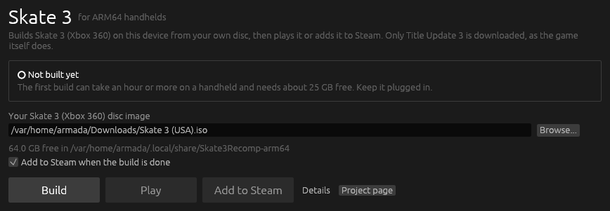
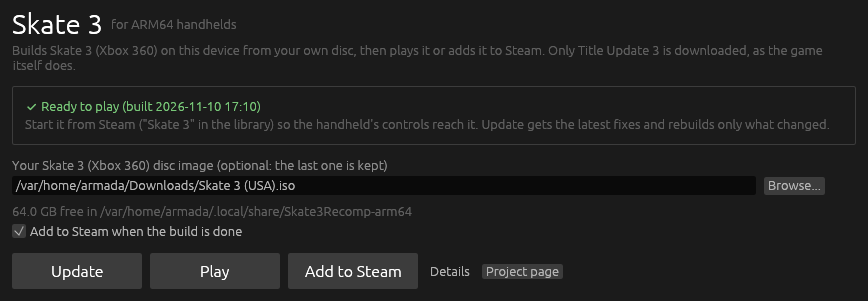

# skate3-recomp-arm64

Skate in San Vanelona on a Snapdragon handheld. This builds
[Skate 3 Recomp](https://github.com/mchughalex/skate3recomp), the native PC
recompilation of the Xbox 360 *Skate 3*, as a native linux-arm64 program on
[ArmadaOS](https://armadaos.dev/) devices such as the Retroid Pocket 6.

  
  

Upstream publishes Windows, x86-64 Linux and Apple Silicon builds. Its Linux
build only runs on x86-64, and Skate 3 Recomp has no licence, so no game
binaries can be shared anyway. Here the game is compiled on the handheld
itself from your own disc. It needs no Android layer, no FEX and no Proton.

## Install

You need an ISO of your own **Skate 3 for Xbox 360** and about 25 GB free.

1. In **Desktop Mode**, download `Skate3Recomp-Launcher-linux-arm64.tar.gz`
   from the [latest release](https://github.com/Ken5998/skate3-recomp-arm64/releases/latest),
   extract it to your home folder and open `Skate3Recomp/skate3-launcher`.
2. Pick the disc image and press **Build**. The launcher looks for one in
   Downloads, ROM folders and SD cards. Leave the handheld on the charger:
   the first build compiles the whole recompiled game and takes an hour or
   more.
3. Start **Skate 3** from Steam, because the handheld's controls reach the
   game only when Steam starts it. **Play** in the launcher works too, with a
   pad that is already connected. The shortcut comes without artwork, so pick
   your own on SteamGridDB.

The build copies the disc's files into
`~/.local/share/Skate3Recomp-arm64/game-dist/game`, the same way the game's
own "Select ISO" installer would. After that the ISO is no longer needed. The
build also downloads Title Update 3 from xboxunity.net, as the game's
installer does, because the recompilation is generated against it. If you
already have the file, put `TU_12K2276_000000C000000.00000000000O3` in
`~/.local/share/Skate3Recomp-arm64` before building. **Update** in the
launcher pulls the latest fixes from this repository and rebuilds only what
they change.

## Settings

The game draws with Skate 3 Recomp's native Vulkan renderer. It runs the
game's own shading directly on the GPU, so it is much lighter than the
emulated Xbox 360 GPU. On the first start
`game-dist/skate3.toml` sets these handheld defaults:

- 1x resolution scale (720p, the console's resolution), vsync on at 60 Hz
- MSAA, SSAO, light shafts and screen-space reflections off
- stock draw and LOD distance (upstream doubles them)

After that, change anything in the game's own Settings: **Escape**, or
**RB + Start** on the pad. **F5** switches between the native and the emulated
renderer at any time, which helps when something looks wrong. Upstream lists
the native renderer's known issues: skater customisation, Hall of Meat and
skate park rendering.

If MangoHud or the Steam overlay flicker, turn GPU preemption off with the
kernel option `msm.enable_preemption=0` and restart.

## How it builds

- `scripts/prepare.sh` checks out Skate 3 Recomp at the commit in
  `upstream.json` with its fork of the ReXGlue SDK, and applies
  `patches/game`, `patches/sdk` and `patches/imgui`. The SDK fork records an
  imgui commit that was never published, so imgui comes from its last public
  commit, plus the one font setting the fork needs.
- `scripts/build.sh ISO` does the rest on the handheld. It fetches the pinned
  LLVM toolchain and an Ubuntu 24.04 arm64 sysroot with GTK 3
  (`toolchain.json`, built by `scripts/build-sysroot.sh`). Then it copies the
  game files out of the disc, downloads Title Update 3, runs codegen with the
  recompiler built for arm64, builds the game (ARMv8.2, tuned for the RP6),
  writes `game-dist/skate3.sh` and adds the Steam shortcut.
- CI builds the game natively on an ARM64 runner in Fedora 44, and
  cross-compiled on x86-64. No game files are ever involved, so it uses
  placeholder recompiled code.

## Legal

This repository contains no game files, no code generated from the game and
no binaries built from it. The game is built on your device from a disc you
own. Skate 3 is a trademark of Electronic Arts. This project is not
affiliated with or endorsed by Electronic Arts, Microsoft or the Skate 3
Recomp author.

## License

The scripts, the launcher and the patches are MIT. Skate 3 Recomp has no
licence of its own and is downloaded from its repository at build time. See
[NOTICE](NOTICE).
